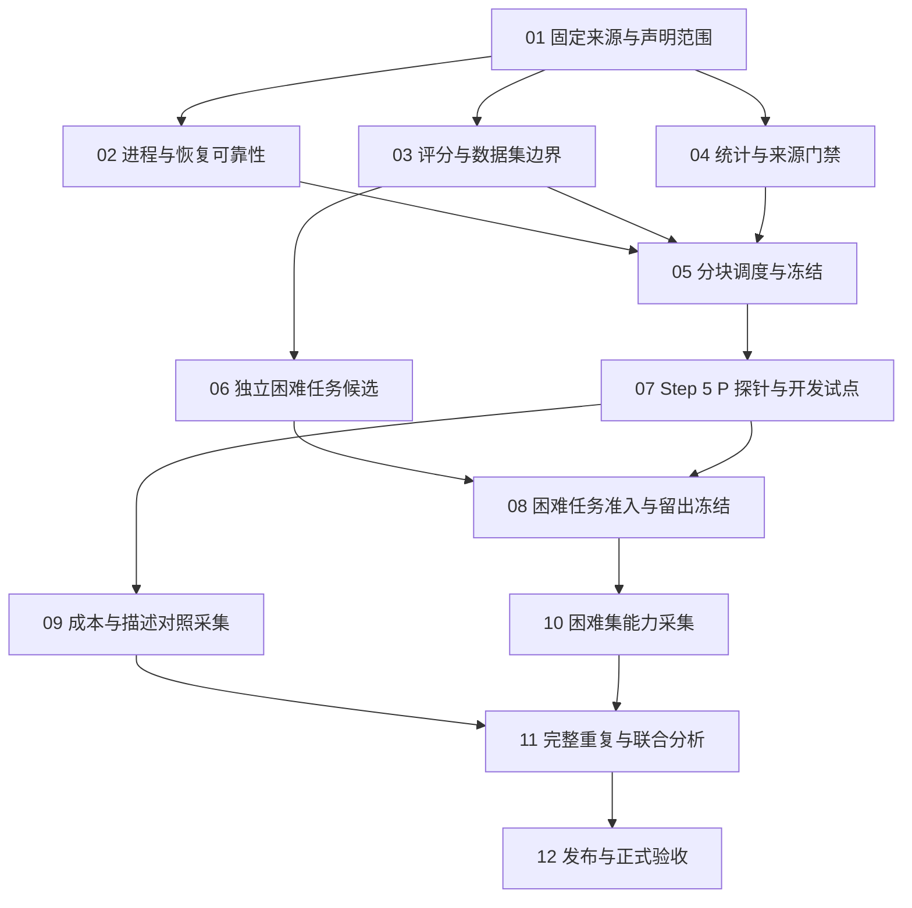

# VerseShell 短板修复策略

日期：2026-10-06。状态：**待执行策略，不是新实验的冻结预注册，也不是验收完成声明。**

## 1. 目标与当前起点

目标是得到可信、可复现、能明确解释适用范围的工程与性能结论。验收通过指实现、测量和结论一致；实验未发现收益也可以是合格结果，不以“必须证明 D 更好”为目标。

当前起点来自 [c20/c21 修复报告](c20-c21-repair-2026-10-06.md) 与
[验证记录](../audit-r12-scratch/repair-2026-10-06/verification.json)：171 项 Python 测试通过、35/35 任务审计通过。它们是上一轮留下的离线证据，本轮未重跑测试。新端点实测、完整 Rust 验收、困难任务与重复性都未完成。

本轮核对了任务森林的 list/todo；以下编号是策略工作包，不是新增 Task Forest 节点。现有 canonical 状态未改变。

### 三条独立交付线

| 交付线 | 回答的问题 | 达成条件 |
|---|---|---|
| 工程可靠性 | 评分、执行、恢复、报告是否可信 | 故障注入、负控、完整网格和实际输入指纹全部可核验 |
| 当前分布的成本 | 在冻结任务与模型上是否减少调用/usage | 双口径、双估计量、区间、完整性、校正与重复性支持；没有价格时不谈金额 |
| 新分布的能力 | 在独立困难任务上是否更能解决问题 | 独立来源、留出集、行为判据、正向余量、预注册功效和实测全部满足 |

不能用第一条的测试通过代替后两条，也不能用成本下降代替成功率提升。

## 2. 执行顺序与依赖

02/03/04 是可独立推进的工作，不要求并发 agent 或并发测量。端点上的调用串行；正式 study 的全部实现、分析代码和配置在首格前冻结。

**立即实施顺序：01 → 02 → 03 → 04 → 05；同时准备 06 的离线 schema/准入/来源清单。** 不等 Step 5 P 才开始这些修复。

## 3. Step 5 P 到位前的工程工作包

### 01 — 固定来源与声明范围（P0）

- 清点本轮修改、旧脏改动、源码/二进制/工具链与评分器指纹；保存本轮变更边界，避免把整个工作区 diff 当成本轮修改。
- 建立 study 的显式输入清单：任务版本、fixture、评分器、提示逐字内容、tools schema、模型别名与可获得的版本、协议、参数、权限、调度、重试、分析器。
- 将旧 35 题标为已看过的工程/回归数据；按任务 `kind` 和来源分别报告，不把 mechanics/regression 混成纯能力结果。
- 保留 c20/c21、旧 eval 与历史判词。读旧证据可以，发布当前声明必须重新验证对应输入。

**交付**：来源/声明矩阵和本次改动清单。**通过标准**：每条拟发布声明可追到唯一输入集合；缺失来源明确阻塞，不用“latest”猜。

### 02 — 消除启动窗口并验证中断恢复（P0；对应 TF-0122 的剩余工程范围）

修改入口：`bench/aci/runners/live_agent_loop.py` 的 bounded process 路径及 `live_journal.py`/`live_identity.py` 的恢复路径。

1. 先评估复用 `src/process_lifecycle_windows.rs` 已有的 suspended launch → 资源绑定 → ResumeThread 顺序；该路径涉及 PTY，不能未经对比就直接替换普通管道执行。`src/process_runner.rs` 也有 Job 绑定逻辑，先检查可复用边界。
2. 必须保证命令开始执行前已受 Job 管理。优先平台现有实现或小型有界 launcher，避免依赖 CPython 私有线程句柄或另造通用进程框架。
3. 正式测量模式下，Job 创建/绑定失败就停止该次命令并登记 harness fault；不得让未经管理的命令继续执行，再把结果当普通模型失败。诊断回退若保留，应显式标记不可用于正式测量。
4. 覆盖正常退出、超时、继承管道、子孙进程、绑定失败、父进程中断和清理失败。验证实际子孙进程存活状态、句柄数量趋势和收束耗时，不能只测函数返回够快。
5. 注入“请求发出后、回包后、观测落盘前、row 落盘后”的中断。区分请求 attempt 与评测 cell；恢复必须保留重试额度和未知请求，禁止声称付费调用 exactly-once。
6. 将外部 kill 的可观测证据、进程退出码、最后心跳与最后 attempt 对齐。无法定位终止来源时写 unknown，不把监督器自动拉起当作根因已修。

**交付**：进程/恢复补丁、故障矩阵及日志。**通过标准**：本次可控故障下无执行逃逸或遗留进程、无重复 row/丢失已提交 row、恢复拒绝变更身份；原 <8 秒超时回归继续通过，并记录实际配置的清理上限。

### 03 — 评分器契约与数据集准入统一（P0；D1/D9 后续）

入口：`task_sets.py`、`task_set_audit.py`、`task_admissibility.py`、`semantic_checks.py`、`task_design_audit.py`。

- 审计、准入、难度诊断和实际执行都显式接收同一 task set/输入路径。尤其修复仍硬编码 canonical 输入的下游入口，不能只给 C24 加参数。
- 采用同一评分契约；列明 live/mock 对缺工具链、超时、坏 regex 的三态区别。若 mock 保持布尔值，应标成 mock 自检，不向 live 能力报告传播。
- 对变更过的谓词补正负控：外围空白等价、内部错误不等价、替代正确实现、篡改测试、硬编码、空输出。不得把所有字符串规则一律放宽为 contains。
- 行为评分的可信测试材料应独立保存/校验；不能仅检查测试文件中还保留某个子串，就认定评分器未被篡改。
- 对全部必需任务检查 coverage；GOLDEN 缺失、谓词未知、工具链不可执行应阻断准入或标为未验证，不能被“跳过任务后 100%”掩盖。

**交付**：逐任务谓词/正控/负控/来源矩阵。**通过标准**：全部有效任务有评分证据；错误方案失败；正确变体通过；依赖缺失不记能力失败；版本/任务遗漏会让 CLI 和门禁失败。

### 04 — 从“可补算”升级为“可确证”的统计链（P0）

入口：`live_uncertainty.py`、`acceptance_power.py`、`repeated_run_uncertainty.py`、`three_arm_report.py`、`claim_gate.py`。

1. **输入新鲜度**：当前报告记录了实际 `input_sha256`，C12 的通用检查仍主要核对 globs。让门禁逐个重新验证实际输入摘要、依赖图和模型/任务/评分器/配置兼容性；写了摘要不等于消费端检查了摘要。
2. **双视图**：正式主报告统一输出 analysable 与 ITT；all_rows 只能明确标成附加视图。未知 success 与缺失 usage 不静默补零；每个估计量单独报告有效分母、排除与原因。
3. **双估计量**：总量比值与配对比值均值都接入完整重复分析。配对比值均值是按 cell 等权，另给先汇总 seed 的任务等权敏感性；不能混称。
4. **CPST 区间**：在任务/完整运行层重抽时同步重算 token 总量和成功数，构造 D/A 的每成功一次 token 比及成功率非劣效界。零成功、缺 usage 或不可用 bootstrap 样本显式使该项不可用，不删掉坏样本。
5. **检验方法**：现有 CI 近似 p 值保留为历史方法；新确证 study 先选择并验证适用于配对、偏态比值、任务/运行相关性的检验或同步区间方案。用零效应、异方差、零分母、强任务相关、少数重复做模拟校准，记录假阳性/覆盖误差及随机种子。不能直接把普通 bootstrap 的尾部比例叫 p 值，也不凭 3 次运行保证覆盖率。
6. **家族与门槛**：在首格前列出全部待确证的对照 × 指标 × 变体，统一确定多重比较规则；新增 usage 双估计量和描述交互不能悄悄塞进或绕过旧 7 项效果家族。保留原冻结阈值，任何新家族只能用于新 study。成功率功效诊断与效果检验分列。
7. **计算开销**：bootstrap 从已聚合的 task/run 充分统计量重算，固定分析 seed；优化必须保持原结果或在版本说明中解释变化，不以抽样次数过低省时间。

**交付**：统计契约、分析器补丁、独立计算/合成控制验证。**通过标准**：未知/不完整/未校正不能变 claimable；所有确证项具有有效区间、家族、分母及版本；校准未通过的项保持探索性。

### 05 — 支持分块对照的冻结调度（P0；新实现需求）

入口：`tools/live_round.py`、`live_identity.py`、`live_journal.py` 及现有 merger；尽量复用单格执行和 journal，不新增第二套 runner。

- 当前 CLI 的两个整轮 tag 可用于工程筛查，**不足以排除跨轮时间漂移**。正式描述对照需要以 task × seed 为 block，在 block 内对六个条件组合做预生成的平衡随机顺序，端点串行执行。
- 六组合为 raw / coached / ACI × baseline / compact_all。静态前缀码点、UTF-8 字节、tool/schema 内容及首轮 endpoint usage 都记录；不要求天然不同的工具集长度相等。
- cell 身份必须包含 study、完整采集号、task、seed、condition、prompt_variant、run_index；合并与断点恢复都验证。变体不能因共享 condition 而覆盖或被当作重复行。
- 已有同样程序重跑时可以预先指定新的调度顺序，但不能看结果后变顺序。整个排序、尝试额度、暂停与继续规则加入指纹。

**交付**：离线可审查的完整 schedule 和 dry-run manifest。**通过标准**：网格无缺失/碰撞；每块组合齐全；重启沿用相同计划；源码/模型/协议改变拒绝续跑；可模拟完成全部网格，不需端点。

## 4. 困难任务与外部有效性

### 06 — 独立来源与开发集（P1；TF-0114、TF-0115、TF-0123）

立即可做：定义任务蓝图、语言/题型/规模配额、schema、准入规则、来源日志与 development/holdout 切分规则。

- 复用 [任务生成协议](task-generation-protocol.md)：A1–A8、至少两个正确变体、至少一个不同模型家族、盲看 GOLDEN、机械篡改负控。实际 author 调用和回退来源必须留证，不凭别名证明异源。
- 对 Step 5 P 家族未知的情况，标 unknown；使用来源可确认的作者或独立公开/人工材料来支撑异源组，不能自行认定另一个 relay 别名就是不同家族。
- 题型针对真实复杂度：多文件约束、异步/状态转换、行为边界、真实构建诊断与局部修复。不能靠无意义日志堆到 large，也不能按 D 的擅长操作设计题。
- 全量保留被准入拒绝的候选及原因；不要用 c20/c21 哪个模型在哪题失败来决定新题。
- 大观察至少 1/3、pristine 实测 ≥1000 proxy tokens 依照现有规则，且与难度分开核验。TF-0123 的历史“还差 7 题”不能当新集合的固定目标，按新分母重算。

### 08 — 开发校准、准入和留出冻结（依赖 06、07）

- 在 development 集上校准基线难度，现有目标 0.40–0.70 作为开发设计目标；不要在正式 holdout 上筛选“成功率合适的题”。
- 冻结题型蓝图、切分规则和准入后，生成/抽取独立 holdout。正式 holdout 即使仍有天花板也如实报告，不删题重做一份“正式结果”。
- 能力任务数、语言和题型覆盖至少满足现有协议；样本规模由独立开发集或保守相关性/缺失情景推导，正式分析前冻结。不能看到确证区间跨线后不断追加。
- 若只有 Step 5 P 可调用而没有独立作者/变体证据，可以先交付工程成本实验；能力与异源泛化声明保持未完成。

**交付**：开发集审计、所有候选来源、独立变体/负控、holdout hash 与版本。
**通过标准**：来源隔离可证、行为评分可运行、覆盖达标、数据未泄漏；难度目标是开发标准，不是正式数据的事后筛选标准。

## 5. Step 5 P 到位后的采集

### 07 — 端点探针与开发试点（P0；TF-0120、TF-0121、TF-0122）

需要输入：精确 model id、base URL、认证配置、协议、可获得的版本信息，以及调用预算/限额。

- 验证目标模型覆盖确实到达 runner；Responses/chat 的工具调用往返、Unicode、usage 完整性、reasoning/finish_reason 缺失标记、超时与限流均有记录。
- 在非 holdout 的预定开发任务上测延迟、实际预算截断与失败率。旧 relay 的 300 秒上限不能自动套到新端点；提高 max_tokens 也不一定可行。
- max_turns=80 / max_tokens=16384 仅是旧工程配置起点。探针需要改变配置时先改开发配置，再冻结新正式版本；新 study 不拼接旧配置的数据。
- 暂停规则按端点/资源/协议故障定义并提前写入；真实解题失败、撞预算不能被当作重试理由。所有请求尝试计入工程消耗，不仅统计成功回包的 usage。
- 探针与校准调用单独计费/计数，不作为正式样本。

**通过标准**：身份正确、工具协议正常、usage 可用、预算与超时规则可执行；有不兼容就先修/重新冻结，不盲跑数百格。

### 09 — 当前分布的成本与描述处理效果（P1）

第一层用旧 35 题做工程验证，可比较修复后管线表现，不能把任务重新命名为盲评集。
baseline/compact_all 的正式比较使用 05 的六组合分块调度和 04 的分析。

解释限制：这个实验检验的是**这套描述改写在不同接口上的效果**。compact_all 改变了语义描述及长度，不是严格的纯长度操纵，不能证明长度无关或普遍接口因果。
若要研究纯前缀构造，另走 [L1 v2](l1-causal-experiment-preregistration-v2.md) 的四臂方案；它尚未冻结且 max_turns=20，与当前工程配置不同，不混用或默认追加。

### 10 — 新困难集能力实验（P1）

只运行通过 08 的新集合，先冻结主张、样本规模、cap 处置与分析家族。成功率看配对差、区间、MDE、非劣效和正向余量，不只看 D 的点估计。
将 cross_family / same_family / unknown、语言/题型等预定分层完整报告；小分层只作描述，不逐个挑显著值。

### 11 — 完整独立重复与可选消融（P1；TF-0112）

复用 [完整重复协议](repeated-run-protocol.md)：每种冻结配置至少 3 次完整采集，相同任务、seed 集合、预算和源指纹；3 seed 不是 3 次重复。
分析保留 task × run 两轴，现有工具需在 04/05 中扩展以支持变体/交互/双估计量，不能直接称已支持六组合实验。

read_files 消融是单独问题。只有要发表该机制声明才增加 without；同模型、同任务、同配置成对采集。使用现有完整三臂 with/without 方案时格数翻倍，不从历史其他模型借 without。

## 6. 工作量与停止规则

| 方案 | 格数 | 用途 |
|---|---:|---|
| 旧集合单变体工程轮 | 35 × 3 seeds × 3 conditions = 315 | 管线/成本筛查，不保证确证 |
| 旧集合双变体工程轮 | 35 × 3 × 3 × 2 = 630 | 描述对照筛查，正式时需分块调度 |
| 上述双变体三次完整采集 | 630 × 3 = 1890 | 补跑间不确定性，仍是已看过的任务 |
| 新集合 token 对照示例 | N × 5 seeds × 3 conditions × 2 variants × 3 runs = 90N | 沿用任务生成协议 token 每题至少 5 次与独立完整重复要求；N=30 时 2700 格 |

格数不是请求数，也不保证功效；token 每题 5 次与完整采集 3 次属于不同维度。最终 N/seed 数由冻结前的精度/功效设计决定，不能把工程轮 3 seeds 偷换成正式 token 规模。

先完成 01–05，再做 07；不要在 runner、评分器、统计或调度还会改动时提前烧正式预算。
墙钟/usage 预算用 Step 5 P 试点观测估计，包含重试、校准、评分和清理；旧模型 4–5 小时/轮不是新模型承诺。

若任一比较的 endpoint/cap 超过现有 §0.6 门槛、身份变化、缺失可推翻结论或功效不足，保留全部数据并判为不支持主张。停止增加正式样本；后续改善属于新的预注册 study。

## 7. 发布与验收（12，P1）

1. 为每条声明生成相同来源的一组报告；在暂存目录验证依赖、摘要、完整性和统计后再发布。刷新链应支持 collection 输入与输出目录，不在中途把 canonical 更新一半。
2. 无 without 的 study 不运行/发布配对消融头条；无跨 shell 新测量时，相关数字保持历史标签。
3. 运行与变更范围对应的 Rust 测试、Python 测试、故障测试和最终 claim gate；记录 exit、数量、跳过项、缺失依赖及所有红项。新鲜度通过不意味着性能门槛通过。
4. C14/C16 按原阈值重新验证；仍失败就继续保留失败，不用 C34 或其他口径冲抵。
5. README/声明矩阵引用明确 study 版本，分别写工程通过、证据不足、效果支持和适用范围。别名身份未知与跨家族边界随结论保留。
6. 基于实际证据再形成 Task Forest 状态变更提案；不能因计划执行完或百分比高就关闭节点。

## 8. 与现有任务的映射

| 当前节点（本轮 CLI 读取） | 当前状态 | 对应策略 |
|---|---|---|
| TF-0112 完整重复运行 | in_progress | 04、05、11 |
| TF-0114 难度与大观察占比 | in_progress | 03、06、08、10 |
| TF-0115 生成器同源风险 | ready | 06、08、10 |
| TF-0120 端点预算上限 | ready | 07 |
| TF-0121 D 臂截断与双口径 | ready | 04、07、12；历史轮次记录不能被新轮次覆盖 |
| TF-0122 失败格与合并恢复 | in_progress | 02、05、07、12；部分代码已落地，仍按端到端证据核验 |
| TF-0123 large 观察机制 | ready | 03、06、08；不能机械沿用历史补题数 |

## 9. 总体验收清单

- [ ] 命令受管后才执行；超时/父进程死亡没有遗留树，恢复不重复提交。
- [ ] 实际评分谓词、任务覆盖、正负控、工具链与三态分类统一可核验。
- [ ] 门禁验证实际输入摘要，而不只是记录摘要；发布来源无跨轮混用。
- [ ] 确证项有区间与多重比较；CPST、usage 缺失和零分母不会给出伪通过。
- [ ] 六组合有冻结分块计划，不能混淆变体与时间漂移。
- [ ] Step 5 P 身份、协议和预算通过开发探针。
- [ ] 困难 holdout 独立、准入通过；没有按正式结果选题。
- [ ] 完整重复、双视图、双估计量和所有预定分层均已报告。
- [ ] 所有产品声明与最终证据一致，旧阈值和红项不被改名消失。

以上全部是待验收项目。本文件完成的是执行策略；后续优先落地 01–05，端点信息到位后进入 07。
